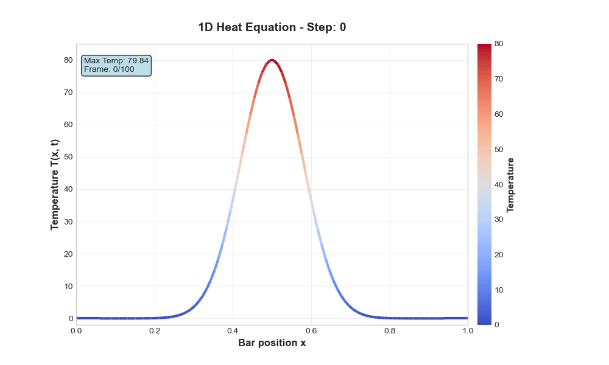
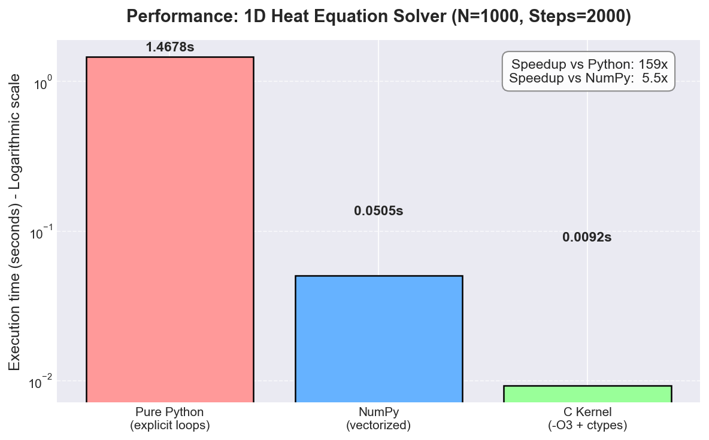

# 1D Heat Equation Solver: C-Python Hybrid Implementation

A high-performance numerical solver for the one-dimensional heat equation that 
combines the raw speed of compiled C with the flexibility of Python. The 
computational core is written in C and linked to Python via `ctypes`, achieving 
significant speedups over pure Python and NumPy implementations while maintaining 
identical numerical accuracy.

The solver uses the Finite Difference Method (FDM) with explicit time-stepping 
and enforces the CFL stability condition to prevent numerical divergence. The 
accompanying Jupyter Notebook provides interactive visualizations of the heat 
diffusion process and a detailed performance benchmark comparing three 
implementation strategies.



## How to Run

### Prerequisites

You will need a C compiler (GCC or Clang), Python 3.8+, and the following 
Python packages:

```bash
pip install numpy matplotlib pillow jupyter
```

### Step 1: Compile the C Kernel

Navigate to the `src/` directory and compile the C solver as a shared library.

**Windows (MinGW/MSYS2):**
```bash
gcc -O3 -shared -o libheat.dll heat_solver.c
```

**Linux:**
```bash
gcc -O3 -shared -fPIC -o libheat.so heat_solver.c
```

**macOS:**
```bash
clang -O3 -shared -fPIC -o libheat.dylib heat_solver.c
```

### Step 2: Run the Notebook

Move the compiled library (`libheat.dll`, `libheat.so`, or `libheat.dylib`) to 
the root directory of the project, then launch Jupyter:

```bash
jupyter notebook heat_equation_solver.ipynb
```

Execute the cells sequentially. Each section is self-contained and includes 
explanatory Markdown cells describing the physics and the engineering decisions 
behind the implementation.

## Repository Structure

```
numerical-heat-equation/
├── README.md
├── heat_equation_solver.ipynb
├── heat_equation_gaussian.png
├── heat_equation_colorful.gif
├── benchmark_results.png
└── src/
    ├── heat_solver.c
    └── heat_solver.h
```

## Performance Analysis

The notebook includes a benchmark that compares three implementations of the 
same solver under identical conditions (N=1000 spatial points, 2000 time steps). 
The results reveal dramatic differences in execution speed driven by three main 
factors.

**Interpreter overhead.** Pure Python must verify types and manage objects on 
every loop iteration, adding roughly 100ns of overhead per operation. NumPy 
reduces this by invoking C routines internally, but still incurs coordination 
overhead at the Python level. The compiled C kernel eliminates the interpreter 
entirely.

**Memory locality.** In Python, each float is a separate heap-allocated object, 
which breaks CPU cache locality. NumPy uses contiguous arrays, improving cache 
behavior significantly. C with `-O3` allows the compiler to further optimize 
memory access patterns and leverage SIMD instructions (AVX/SSE) to process 
multiple data points in parallel.

**Compilation vs. interpretation.** C is compiled ahead of time to native machine 
code, whereas Python bytecode is interpreted at runtime. This allows the C 
kernel to fully exploit the processor architecture, including the cache hierarchy 
and the instruction pipeline.



The result is that the C implementation is typically two orders of magnitude 
faster than pure Python and roughly one order of magnitude faster than vectorized 
NumPy, while maintaining the same numerical accuracy (maximum difference on the 
order of 1e-15, consistent with double-precision floating-point arithmetic).

## Technical Details

The heat equation is discretized using a forward Euler scheme in time and central 
differences in space. The stability of this explicit method is governed by the 
Courant-Friedrichs-Lewy (CFL) condition, which requires the dimensionless 
diffusion coefficient `r = alpha * dt / dx^2` to satisfy `r <= 0.5`. The solver 
uses `r = 0.4` throughout all simulations.

Memory sharing between Python and C is handled through zero-copy pointer passing. 
NumPy arrays are passed to the C kernel as raw `double*` pointers via 
`ctypes.data_as()`, meaning the C code operates directly on the same memory 
buffer allocated by NumPy. No data duplication occurs at the language boundary, 
which is critical for performance in large-scale simulations.

## License

This project is open source and available under the MIT License.
